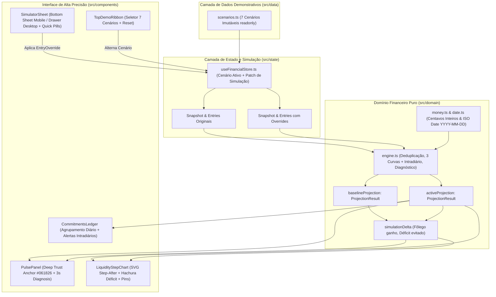

# Arquitetura do Sistema — Fôlego do Mês

## 1. Visão Geral da Arquitetura
O **Fôlego do Mês** foi projetado com arquitetura em camadas enxutas e unidirecionais (**Clean Domain-Driven Frontend**), garantindo que o motor financeiro seja **100% determinístico, puro, independente de React/DOM e exaustivamente testável**, enquanto a camada de interface reage instantaneamente a simulações hipotéticas sem mutar os dados originais.



---

## 2. Organização de Diretórios

```text
Projeto_Agi/
├── docs/
│   ├── INITIAL_PROPOSAL.md      # Proposta base submetida aos subagentes
│   ├── SUBAGENT_REVIEWS.md      # Pareceres críticos dos 4 especialistas e resolução de conflitos
│   ├── ARCHITECTURE.md          # Este documento: contratos, regras matemáticas e ADRs
│   └── DESIGN_SYSTEM.md         # Especificação visual, tokens, tipografia, ergonomia e UX writing
├── src/
│   ├── domain/                  # Camada Pura de Negócio (Zero dependências de UI)
│   │   ├── types.ts             # Contratos TypeScript estritos (Cents, ISODateString, ProjectionResult)
│   │   ├── money.ts             # Aritmética segura em centavos inteiros e formatação BRL
│   │   ├── date.ts              # Aritmética calendárica ISO (YYYY-MM-DD) imune a fuso horário
│   │   ├── engine.ts            # Motor determinístico de projeção, deduplicação e alertas
│   │   └── __tests__/
│   │       └── engine.test.ts   # Suíte com 18+ testes unitários cobrindo todos os casos extremos
│   ├── data/
│   │   └── scenarios.ts         # 7 cenários demonstrativos cobrindo todos os casos de uso exigidos
│   ├── state/
│   │   └── useFinancialStore.tsx # Gerenciamento de estado reativo por Patch (EntryOverride)
│   ├── components/
│   │   ├── TopDemoRibbon.tsx    # Barra superior de instrumentação para alternar os 7 cenários
│   │   ├── PulseHeroCard.tsx    # Painel de Pulso (#061826) com resposta em 3 segundos e KPIs
│   │   ├── SimulationBanner.tsx # HUD sticky mostrando comparativo Antes vs. Depois da simulação
│   │   ├── LiquidityStepChart.tsx # Gráfico SVG Step-After com hachura de déficit e Callout Pins
│   │   ├── CommitmentsLedger.tsx  # Linha do tempo de compromissos agrupada por dia com filtros
│   │   └── SimulatorSheet.tsx   # Bottom Sheet (Mobile) / Modal-Drawer (Desktop) com Quick-Sim Pills
│   ├── index.css                # Tokens CSS do Design System e utilitários Tailwind
│   ├── App.tsx                  # Composição responsiva (Fluxo Único Mobile / Split Editorial Desktop)
│   └── main.tsx
├── vercel.json                  # Configuração de deploy estático e SPA fallback
└── package.json
```

---

## 3. Especificação Formal do Motor Financeiro (`src/domain/engine.ts`)

### 3.1. Elegibilidade e Rebate de Vencidos (*Overdue Clamping*)
Dado `referenceDate` ($t_0$) e `horizonDays` ($H$, padrão 30 dias):
1. Lançamentos com `status !== 'pending'` (`'paid_here'`, `'paid_other_bank'`, `'cancelled'`) ou `affectsMonitoredAccount === false` recebem elegibilidade `'ignored_*'` e **não** afetam o cálculo futuro.
2. Lançamentos `'pending'` com `effectiveDate < referenceDate` (contas vencidas e ainda não pagas) **não desaparecem**: são alocados em `projectedDate = referenceDate` ($t_0$) com `isOverdue = true`, impactando imediatamente o fôlego disponível.

### 3.2. Deduplicação Determinística (5 Critérios Anti-Colisão)
Para evitar que o cliente tenha uma mesma conta descontada duas vezes (ex: boleto capturado via DDA + lembrete cadastrado manualmente) **sem** ocultar dois pagamentos legítimos de mesmo valor (ex: dois Pix de R$ 50 no mesmo dia):
Dois lançamentos ativos $a$ e $b$ só são deduplicados quando:
1. `a.type === b.type`
2. `a.amountCents === b.amountCents`
3. **Origens Cruzadas Compatíveis:** Um vem de fonte bancária estruturada (`'dda' | 'debito_automatico' | 'pix_agendado' | 'folha_pagamento'`) e o outro vem de fonte preditiva/manual (`'manual' | 'recorrente_historico'`), **OU** ambos possuem a mesma `dedupeKey` explícita. Dois itens da mesma fonte estruturada (`dda` + `dda` ou `pix_agendado` + `pix_agendado`) sem `dedupeKey` idêntica nunca colidem.
4. **Identidade Semântica Normalizada:** Títulos normalizados (sem acentos, caixa e stopwords como *"boleto"*, *"conta"*, *"pagamento"*, *"fatura"*) são equivalentes ou um contém o núcleo semântico do outro.
5. **Janela Temporal Estrita:** $|\text{daysBetween}(a.\text{dueDate}, b.\text{dueDate})| \le 3\text{ dias}$.
- **Sobrevivente Determinístico:** Prevalece sempre a fonte mais concreta (`debito_automatico > pix_agendado > dda > folha_pagamento > manual > recorrente_historico`). O item preterido recebe `eligibility: 'deduplicated'` e `deduplicatedOfId: survivor.id`.

### 3.3. As 3 Curvas Diárias + Risco Intradiário
Para cada dia $d \in [t_0, t_0 + H]$:
- **Curva 1 (`closingConfirmedCents`):** `availableBalanceCents` acumulado apenas com `inflow(confirmed) - outflow(confirmed)`.
- **Curva 2 (`closingProjectedCents`):** `availableBalanceCents` acumulado com `inflow(confirmed + estimated) - outflow(confirmed + estimated + uncertain)`. *(Representa a projeção realista sem depender de recebimentos incertos/atrasados).*
- **Curva 3 (`closingOptimisticCents`):** Igual à Curva 2, somando também `inflow(uncertain)`. Permite saber matematicamente se o recebimento incerto/atrasado é o fator que salva o mês.
- **Mínimo Intradiário (`intradayMinCents`):** `openingConfirmedCents[d] - confirmedOutflowsCents[d]`. Se `intradayMinCents < 0` mas `closingConfirmedCents >= 0`, marca `intradayTimingRisk = true` (alerte o cliente de que o débito pode ocorrer de manhã antes de o crédito cair à tarde).

### 3.4. Tabela Verdade dos 4 Estados de Alerta Inteligente
1. **`INSUFFICIENT_DATA` (Informações insuficientes):** `!hasCompleteData` ou `availableBalanceCents === null` ou `Number.isNaN(availableBalanceCents)`.
2. **`PREVENTIVE_ALERT` (Alerta preventivo):** Existe algum dia em que `closingConfirmedCents < 0` **e** mesmo na curva otimista (`closingOptimisticCents < 0`) o compromissos confirmados não são cobertos (ou não há recebimento incerto pendente que cubra o rombo confirmado).
3. **`CONDITIONAL_WARNING` (Aviso condicional):** Emitido com subtipos explícitos em `warningReasons`:
   - `'ESTIMATED_OUTFLOW_RISK'`: `closingConfirmedCents >= 0` todos os dias, mas `closingProjectedCents < 0` em algum dia por causa de despesas estimadas.
   - `'UNCERTAIN_INFLOW_DEPENDENCY'`: `closingConfirmedCents < 0` em algum dia, mas `closingOptimisticCents >= 0` (a cobertura das contas confirmadas depende de um recebimento marcado como `uncertain` cair até a data).
   - `'INTRADAY_TIMING_RISK'`: O saldo de fechamento é positivo (`>= 0`), mas `intradayMinCents < 0` em um dia com entrada e saída simultâneas.
4. **`NO_SHORTFALL_IDENTIFIED` (Sem insuficiência identificada):** Todas as curvas (`confirmed`, `projected` e `intradayMin`) permanecem `>= 0` em todo o horizonte mapeado.

---

## 4. Architecture Decision Records (ADRs) e Trade-offs

### ADR-01: Centavos Inteiros (`Cents`) sem Bibliotecas Externas
- **Decisão:** Representar todo valor monetário como inteiro de centavos (`R$ 142,50` $\rightarrow$ `14250`) validado por `Number.isSafeInteger`.
- **Trade-off:** Exige converter reais para centavos apenas na borda de digitação de formulário (`parseBRLToCents`), mas elimina 100% dos erros de ponto flutuante IEEE-754 (`0.1 + 0.2 !== 0.3`) sem adicionar peso de pacote (`decimal.js`).

### ADR-02: Datas Civis ISO (`YYYY-MM-DD`) Imunes a Timezone
- **Decisão:** Representar datas como strings `YYYY-MM-DD` e realizar somas de dias convertendo para UTC meio-dia (`12:00:00Z`).
- **Trade-off:** Impede que o fuso horário do navegador (`America/Sao_Paulo`, `UTC-3`) desloque meia-noite UTC para 21h do dia anterior, bug recorrente em sistemas financeiros em JavaScript.

### ADR-03: Estado de Simulação por Patch (`EntryOverride`) e Dupla Projeção Paralela
- **Decisão:** Manter os 7 cenários em `scenarios.ts` 100% imutáveis e gravar no estado da aplicação apenas o dicionário `entryOverrides: Record<string, EntryOverride>` + `balanceOverrideCents`. O hook executa `runProjection` para o cenário original (`baselineResult`) e para o cenário simulado (`simulatedResult`).
- **Trade-off:** Como o motor processa 35 dias em menos de `0.3ms`, rodar duas vezes via `useMemo` tem custo computacional desprezível e habilita comparações instantâneas (*"Você evitou R$ 340 de déficit e ganhou +16 dias de fôlego"*), além de permitir restaurar um item individual ou todo o cenário em $O(1)$.
